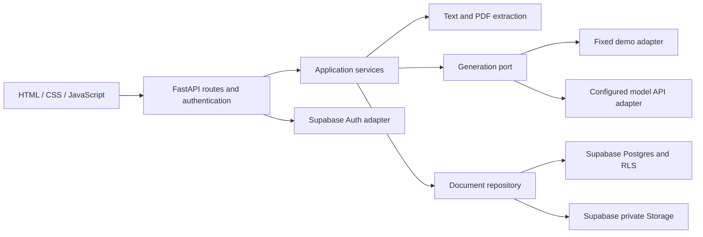
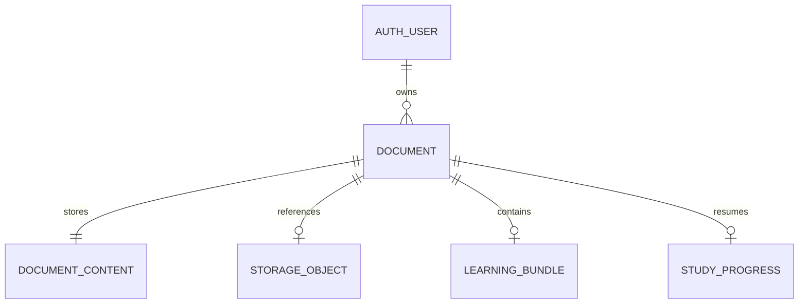

# Architecture Spine — AI Study Buddy

Build contract for v1. [ADOPTED] includes direct user choices and implementation decisions delegated by the user on 2026-11-11. Deferred milestones below do not block the local demo; they gate their affected live/PDF/deployment stories. Final planning status does not claim implemented authentication, persistence, AI, or deployment, and does not authorize paid resources or real private-data processing.

## Design Paradigm

[ADOPTED] One layered application. Browser presentation calls the same-origin FastAPI API. Application services own generation, save/open/delete and progress rules. Extraction, model and persistence adapters implement service interfaces. No microservices, vector search, agent framework or separate frontend build is required.



## Invariants & Rules

### AD-1 — One application boundary [ADOPTED]

- **Binds:** all.
- **Prevents:** incompatible frontend frameworks or private data bypassing server authorization.
- **Rule:** Use Python/FastAPI and plain HTML/CSS/JavaScript in one project. FastAPI serves public UI assets and API routes from one origin. The browser never receives privileged provider keys. Private documents must not be served from the static directory.

### AD-2 — Account identity and owner-scoped access [ADOPTED]

- **Binds:** FR-8, FR-10–FR-12, all private API routes.
- **Prevents:** forged owner IDs, cross-user file access and shared-client session leakage.
- **Rule:** Supabase Auth owns email/password accounts, signup, recovery and logout. Derive owner identity from validated authentication, never a submitted owner field. Postgres and private Storage enforce owner policies for every read/write/delete. Use request-scoped Supabase clients bearing the authenticated user's token; never share a mutable logged-in client across users or use a privileged service key for ordinary document operations. Database migrations are separate administrative operations.

### AD-3 — Session lifecycle and security [ADOPTED]

- **Binds:** FR-8, backend runtime and frontend API calls.
- **Prevents:** incompatible browser-token handling, logout semantics and multi-worker session routing.
- **Rule:** [ADOPTED 2026-11-11] Keep backend-managed login state in memory on one server process for v1. Server restart/redeploy requires signing in again. Saved documents, learning material and acknowledged progress remain in Supabase and must reopen for the same owner after login; simultaneous login from multiple devices remains supported.

[ADOPTED technical decision] Use an opaque random session cookie, HttpOnly, SameSite=Lax and Secure on HTTPS. FastAPI keeps the corresponding provider access/refresh credentials in a bounded in-memory session registry. Validate the registry entry on every private request; refresh provider credentials through the Auth adapter as needed. On logout invalidate the local application entry and clear its browser cookie unconditionally before attempting provider revocation with local scope; other devices remain signed in. A provider outage must never restore local access: discard tokens after the bounded revocation attempt, return local logout success and log only a content-free revocation-failure code. Test that the old cookie is denied during provider outage. Rotate the opaque application session identifier after successful authentication or privilege transition. Serialize refresh per session. Require same-origin checks and a CSRF token on cookie-authenticated state-changing requests. Do not persist passwords, provider tokens or document text in browser storage or logs. Configure confirmation/recovery redirect allowlists and handle expired links explicitly.

[ADOPTED technical decision] Use backend-managed PKCE code exchange for email confirmation/recovery. Keep verifier, random state, initiating-browser cookie binding, purpose and expiry in a short-lived pre-auth registry entry. Isolate verifier storage per pending attempt so signup/recovery in another tab cannot replace it; bound and expire pending entries and test overlapping attempts. FastAPI exchanges the callback code using that entry; never accept implicit token fragments or callback-submitted owner IDs. Recovery creates a restricted session that may only change the password; it cannot read documents. Consume recovery state on success and require normal login afterward. Missing verifier, wrong state/browser, expired/reused code or backend restart produces a restart-recovery action, not a normal authenticated session. The user must open a recovery link in the initiating browser; make this limitation explicit in the email/error UX.

Initial defaults: 30 minutes idle / 12 hours absolute session lifetime, configurable and verified in auth tests. Invalidated or expired application sessions cannot access private endpoints even if an old provider access token has not expired. Client code does not directly call private Supabase data APIs. Mark all private responses Cache-Control: no-store; never cache authenticated HTML, API, callback or download responses in a CDN or service worker. Fixed public assets may be cached.

### AD-4 — One canonical source and stable references [ADOPTED]

- **Binds:** FR-1–FR-7, NFR-1, NFR-3.
- **Prevents:** page renumbering, mixed sources and generated citations to unknown locations.
- **Rule:** Exactly one active input method supplies the generation. Normalize it into ordered source units with stable IDs, kind (paragraph/page), original one-based location and text. Retain blank PDF page positions and report pages without usable text. Reject inputs above 40 physical PDF pages or 30,000 source-text characters, without truncation and before live AI calls. The model returns source-unit IDs; the server resolves them into display references and rejects unknown IDs. Course context never supplies unsupported factual content.

[ADOPTED] Normalize CRLF/CR to LF; count Unicode code points of the canonical extracted/pasted text before adding reference labels. Number nonempty text paragraphs separated by blank lines; number PDF units by physical page. Preserve the accepted source representation alongside saved results so later library upgrades cannot change existing references.

### AD-5 — One generation contract for demo and live [ADOPTED]

- **Binds:** FR-3–FR-9, NFR-1, NFR-2, NFR-4.
- **Prevents:** incompatible result shapes, hidden extra calls during study and accidental fake/live mixing.
- **Rule:** Both adapters return a validated LearningBundle with source/settings identity, schema version, summary, concepts, flashcards, quiz, warnings and per-section insufficiency messages. Each generated item carries a stable ID and references to source units. One user action requests all four sections; tab, reveal, navigation and saved reopen never call the model. Live generation never silently falls back to fixed answers. Failed/invalid generation preserves the browser input/settings and offers explicit retry; do not expose a partial bundle as complete. Demo is visibly labelled and accepts only the documented fixture semantics.

Initial live strategy: one bounded request per action with structured output and no hidden automatic retries. Set timeout/output limits after provider selection. Structural/reference validation is not proof of factual accuracy; retain the PRD's three-document evaluation.

### AD-6 — Explicit save and consistent snapshots [ADOPTED]

- **Binds:** FR-10–FR-12, generation and library.
- **Prevents:** auto-saving unsaved material and combining results with the wrong source.
- **Rule:** Upload/generation alone does not persist the workspace. Explicit Save stores the source snapshot, settings and current learning bundle under the authenticated owner. New session clears only active browser state, not saved documents. My documents lists only that owner's ready records. Open returns the stored bundle without regeneration. Replacing saved source/results requires another explicit Save.

[ADOPTED] Save uses an owner-scoped idempotency key and expected document revision. The first Save of an unsaved generation captures its current validated flashcard/quiz item IDs independently; absent/insufficient exercise sections have no position. A Save of a replacement generation atomically replaces the current saved revision and resets progress to that generation's initial available items; no history browser is exposed. A stale revision returns conflict without changing source/results/progress; the UI must reload or explicitly Save as a new document. Ordinary progress writes cannot overwrite source/results.

[ADOPTED] Generation returns a short-lived server-signed receipt binding authenticated owner, application session, workspaceId, workspaceRevision, receiptId, generationId, canonical source/settings/bundle hashes and uploaded-file digest when applicable. Use one schema-versioned deterministic UTF-8 serialization for these hashes across generation/save. For admission of a new Save, resubmit the accepted snapshot/bundle and original file when needed; validate receipt, hashes, schema, current receipt identity, unchanged originating session and ownership before creating a durable admitted operation. Receipt lifetime is 30 minutes from generation. An operation not yet admitted requires that unexpired current receipt; an already-admitted immutable Save resumes under AD-8 instead, and completed operation replay follows AD-8. A changed input or new generation invalidates previous receipt authority as specified below. Do not trust client-modified model results or persist unsaved source/results just to validate a later save. Expired/mismatched receipts for a never-admitted Save return a clear regeneration action. The receipt signing secret is server-only and rotation invalidates outstanding receipts without modifying already-saved content. Reopening existing saved content uses its document/generation IDs and expected revision, not an expired generation receipt; any new generated replacement needs its own receipt.

Receipt authority is a bounded in-memory server registry keyed by authenticated application session and random workspaceId (at most 8 workspaces per session; expire entries after 30 minutes). Each entry holds only workspace revision, current generationId/receiptId, expiry and accepted hashes; it contains no source text, learning results or file bytes and is never persisted/logged. Generation, invalidation and Save admission use the same per-workspace mutex. Starting generation atomically increments the workspace revision and revokes the previous receipt; issue a fresh random receiptId and generationId only on successful generation for that revision. Save admission compares the signed identity and revision with the current registry entry, not merely the signature. A signed but superseded/revoked receipt is rejected. Duplicate requests use their original request ID; an older generation response cannot install authority over a newer revision.

Source/settings edits and New session/reset invoke an authenticated, same-origin/CSRF-protected invalidation action for that workspace; advance its revision and clear current receipt authority. The browser disables Save immediately and awaits acknowledgment before enabling a newly generated result; failed/uncertain invalidation requires retry/reload, never a local-only flag. Starting a new generation also invalidates, independently of the edit event. Logout/session expiry/server restart discard the registry; eviction or receipt expiry requires regeneration for a new Save. A malicious unsent browser edit cannot be inferred by the server: hashes still prevent saving any changed snapshot under an old receipt, and server-observed invalidations make even an unchanged old snapshot's receipt unusable. Admission that wins the mutex before an invalidation freezes only that explicit Save's immutable accepted snapshot under AD-8; later input edits cannot mutate the admitted operation.
### AD-7 — Progress belongs to a saved generation [ADOPTED]

- **Binds:** FR-5, FR-6, FR-11 and cross-device access.
- **Prevents:** progress leaking between owners/documents, stale indices after regeneration and unintended source saving.
- **Rule:** Keep card/quiz positions independently per owner, saved document and generation ID. For unsaved work, progress remains browser memory only. Reopening a saved document resumes its stored positions with both flashcard and quiz answers hidden [ADOPTED 2026-11-11]; reveal each answer only on request. New successful generation resets positions/reveals. Tab switches preserve current in-memory positions and reveal state.

[ADOPTED 2026-11-11] Persist flashcard and quiz position changes automatically only for an already-saved generation; this never auto-saves edited source/settings/results. Unsaved work remains in browser memory only.

[ADOPTED 2026-11-11] Continue from acknowledged progress on another device. An outdated device/tab must not overwrite newer saved progress. Show "Fremdriften er endret på en annen enhet" and require "Hent siste fremdrift" before accepting further progress writes from that view; never silently retry the stale position over the newer one. Show pending/failed synchronization when the network fails; only server-acknowledged progress is guaranteed on another device.

[ADOPTED technical decision] Store stable item IDs rather than raw indices; validate membership. Use a monotonically increasing progress revision: conflicting updates return conflict and require reloading saved progress. Serialize progress writes per browser document and coalesce rapid navigation; submit both independent item IDs with expected revision and a unique mutation ID. The atomic RPC records the mutation ID and response with the accepted revision. A retry of the same ID/payload returns its original outcome without rewriting, while reuse with changed payload is rejected. Retry a transport failure with the same ID at most once, then require explicit retry/refetch. A revision conflict blocks writes until Hent siste fremdrift; it must never blindly rebase an old position. Render acknowledgments only for the current owner/document/generation/request sequence.

Progress mutation atomically checks owner, ready document state, expected current generationId and expected progress revision while locking the document row. Generation replacement and deletion take the same lock. Writes targeting superseded generations or deleting documents fail without recreating rows. Late browser responses must be discarded after source/reset/account changes; request sequence IDs suppress out-of-order UI updates.

### AD-8 — Save/delete span files and database [ADOPTED]

- **Binds:** FR-10, FR-12, Storage/Postgres adapters.
- **Prevents:** incomplete records looking saved, orphan files and falsely successful deletion.
- **Rule:** A database transaction creates document/content/progress records as one ready unit; uploaded files are stored privately under owner/document IDs. Coordinate file work with pending/ready/deleting states because file storage and database writes are not one transaction. Idempotent retries resume the same operation. On failed save, keep the active workspace and report failure; clean provisional files before marking the operation failed. Hide pending items from the ready library, but surface recovery status to their owner. Deletion first marks the item deleting and blocks read/open/progress, then removes its file and associated rows; report success only when all steps succeed. Failed deletion remains visible as a deleting/error item with retry. Never serve a deleted item through a cached public URL.

Implement multi-row database mutations through versioned authenticated Postgres RPC functions, SECURITY INVOKER with RLS and explicit owner checks, fixed search path, no anonymous execution, transactional row locks and compare-and-swap revisions. Do not simulate a transaction using separate REST inserts. Migrations define constrained references and the same lifecycle rules used by ordinary reads.

Every Save/Delete operation key is bound to authenticated owner, document/generation identity and an immutable canonical request digest. Changed-payload key reuse is rejected. After authentication, replay a completed identical operation outcome before checking its original receipt expiry or expected revision; never mutate again. Replays return operation status/IDs only, with current ownership/lifecycle checked before any content read. Retain minimal content-free operation results/deletion tombstones for 7 days; a never-admitted Save requires an unexpired current generation receipt, whereas an admitted pending operation uses the immutable recovery authority below. Deleted document IDs are never recreated by retry. Delete of an already-deleted owner operation returns its recorded success. Operation/tombstone cleanup must not remove still-needed object recovery records.

Save admission is the only transition from ephemeral generation to durable staging and occurs only in response to an explicit authenticated Save action. While the current receipt/session is valid, atomically persist an owner-scoped admitted operation containing its immutable request digest, accepted canonical source/settings/bundle snapshot, expected document revision, file digest/size and pre-registered object key. The accepted snapshot is private operation staging under RLS, never an openable ready document. Record validation/admission time and a one-way originating-session fingerprint as audit metadata; never store the session cookie or provider credentials. The immutable Save digest covers owner/document/generation, accepted canonical source/settings/bundle, file digest/size and expected document revision, excluding transport cookies and retry timestamps. Recovery submits the operation key/admitted digest and any matching missing file, not a newly issued receipt for the old generation. This durable admission record—not an expired receipt or old session—authorizes recovery of this exact Save after relogin/restart.

A newly authenticated same owner may explicitly retry an admitted pending Save within 7 days of admission: load the stored accepted snapshot, verify an identical operation digest, and resume only its pre-registered upload/commit steps with current user-scoped credentials. A missing file may be supplied again only if its bytes match the admitted digest/size; changes to source/settings/bundle/target require a new Save admission with a fresh current receipt. Recheck current ownership, non-deleting lifecycle and expected document revision atomically before commit; conflict or canceled/deleted target cannot be bypassed by recovery. No automatic recovery may create a new operation or persist never-admitted work. After 7 days, cancel pending commit under the operation/document lock and erase its staged source/settings/bundle; the operation permits cleanup only, not new uploads/commit. Retain the minimal recovery/object metadata until cleanup is verified. Signing-key rotation revokes new admissions but does not revoke an already-admitted snapshot.

Cleanup of registered provisional/superseded files and replay of completed status require current owner authentication but no generation receipt, unchanged old session or resubmitted private snapshot. Cleanup cannot create content or resume a canceled/expired admission. Unknown or never-admitted operation keys have no recovery authority: return a regeneration/new-Save action without staging anything. Test relogin/restart after admission before upload, after upload before commit, after receipt expiry, and after lost commit response; also test expired/foreign/unknown admission, changed-payload retry, target deletion/revision conflict and cleanup-only expiry.
Save order: create/reuse an owner-scoped pending operation row with idempotency key and unique provisional object key; upload original bytes if present; then one RPC checks the admitted operation, uploaded-object digest/metadata and expected revision and commits content/bundle/progress plus ready state. File paths include generation/operation IDs so replacements do not overwrite the old ready file before commit. Remove the previous object only after the new revision commits. If cleanup fails, retain a durable cleanup-needed operation; owner retry after login resumes it using user-scoped access. A crash at any stage must leave a discoverable operation row, not an untracked object; list/retry endpoints expose owner-only pending/deleting recovery. Never show failure cleanup as completed until objects are removed. Operational stale-operation cleanup must be tested before accepting real files.

Deletion takes the same per-document application lock as file IO as well as the database row lock. It marks deleting, blocks new uploads/commits, invalidates pending saves and durably enumerates every current, provisional and superseded cleanup object key. Retain operation/object records until all keys are removed. Track in-flight/unknown upload outcomes durably: do not report deletion complete or remove recovery records while an upload may still complete. The Storage adapter must prove write quiescence/reconciliation after a crash or timeout before accepting real files; uncertain outcomes remain deleting with retry, never false success. Test delete during a pending replacement, failed previous-object cleanup and delayed upload completion.

Serve private files only through a FastAPI download endpoint that rechecks owner and ready state and streams with user-scoped Storage credentials. Do not issue reusable signed download URLs in v1. Storage read policies must also reject objects belonging to pending/deleting/superseded generations; allow owner cleanup of their recorded provisional objects. Deletion blocks all new retrievals; bytes a user already downloaded cannot be recalled.

### AD-9 — Live deployment and local demo [ADOPTED; hosting vendor deferred]

- **Binds:** NFR-3, NFR-4, runtime and operational setup.
- **Prevents:** a live app depending on one student's running PC or demo requiring private cloud credentials.
- **Rule:** Live mode uses a hosted HTTPS FastAPI service plus Supabase Auth/Postgres/private Storage, with no dependency on host-local document files. Keep local fixed-data demo runnable from README without Supabase/model credentials. Demo must not read/write real cloud content. Use a separate fixed-fixture adapter/route with synthetic data; demo account/library actions may illustrate browser-memory state only. Never accept live private content through a demo authentication bypass, or claim persistence/cross-device synchronization from the demo. Arbitrary source submission must be rejected as unsupported in fixed demo mode; the UI explains how to load the documented example. Keep dev/test accounts and synthetic fixtures separate from real student content; test migrations on disposable data first. Configuration, migrations and example environment files are versioned; secrets and database/file dumps are not.

[PROPOSED] Start with one Render Python web service and one Supabase project in an available European region; exact service region, plan, quotas, email delivery and cost ceilings need approval before provisioning. Redeploying/restarting the backend logs users out but retains saved data. Add a content-free health endpoint; log error codes/request IDs and timing, never sources, model replies, passwords or tokens. Define backup/restore and deletion-retention behavior before using real private material; do not promise instant erasure from provider backups.

## Consistency Conventions

| Concern | Convention |
| --- | --- |
| Identity | UUID owner/document/generation IDs; owner is immutable and server-derived. Reference unit and item IDs remain stable within the saved generation. |
| API | JSON camelCase fields, database snake_case names with explicit repository mapping, UTC ISO-8601 timestamps. Errors contain code, safe message and requestId; no provider response bodies or secrets. Distinguish 401, unavailable/not-owned document, validation, conflict and upstream failure. |
| State | Browser owns active input/tab/reveals. Application services own mutations; adapters do not decide UI behavior. Reject late generation responses after source change/reset/logout. |
| Formats | Schema-versioned source and LearningBundle shared by fixtures, validators, saved reads and live responses. Migration must not silently reinterpret existing references. |
| Validation | Validate type/size before extraction; 10 MiB initial upload ceiling and bounded extraction worker/time limit. Confirm usable limits with PDF experiment; no OCR, table/figure interpretation or encrypted-file password workflow. |
| Library | Title/file name, saved date, resume position, Open and Delete. Escape plain text; never render uploaded content/model output as executable HTML. Confirm deletion naming the item; Cancel changes nothing. |

## Data seed



Documents contain ownerId, title, timestamps, lifecycle state and revision. Content contains the accepted source snapshot/settings and optional private object key. LearningBundle includes generationId and validated JSON payload. Progress includes ownerId, documentId, generationId, cardItemId, quizItemId and revision. Composite constraints/policies must prevent content/progress referencing a document with another owner or generation. Do not persist unsaved generations to implement previews or retry.

## Stack seed

| Name | Version | Status |
| --- | --- | --- |
| Python | 3.13.7 | Locally observed runtime; deployment patch version must be checked before pinning. |
| FastAPI | 0.162.4 | Package release observed 2026-11-10; initial implementation seed, compatibility/lockfile verified by the first build story. Framework adopted. |
| HTML/CSS/JavaScript | Browser-native | Adopted; no frontend build tooling required. |
| Supabase Auth/Postgres/Storage | Managed services | Adopted; no fictional server-version pin. SDK versions remain to lock during setup. |
| pypdf | 7.0.1 | Proposed PDF adapter; extraction experiment must validate fit before adoption. |

Use the official FastAPI first-steps application as the minimal starter; preserve the approved prototype as a UX reference and separate inline code into maintainable UI files during implementation. Do not import a full-stack starter with unused database/auth/frontend systems. Lock runtime dependencies after a clean setup/test; this table is a researched seed; the tested lockfile becomes the exact dependency authority.

## Structural Seed

```text
app/
  main.py           # same-origin static UI and routes
  api/              # authentication, generation, library, progress routes
  services/         # orchestration, ownership, save/delete semantics
  contracts/        # shared source/result/error schemas
  adapters/         # Supabase Auth/repository/storage, PDF, demo/live model
  static/           # public HTML/CSS/JS only
demo/               # synthetic fixtures; no real credentials
supabase/migrations/
tests/              # contracts, ownership, operations and end-to-end flows
```

## Capability → Architecture Map

| Capability | Lives in | Governed by |
| --- | --- | --- |
| FR-1, FR-2, FR-7 | source normalization/extraction and UI settings | AD-4, AD-5 |
| FR-3–FR-6, FR-9 | generation service, adapters and study UI | AD-4, AD-5, AD-7 |
| FR-8 | Auth adapter, application session registry and reset UI | AD-2, AD-3, AD-6 |
| FR-10–FR-12 | repository/storage services, library and progress | AD-2, AD-6, AD-7, AD-8 |
| NFR-1–NFR-3 | validators, source evaluation, ownership/operation tests | AD-2–AD-8 |
| NFR-4, NFR-5 | local demo, README, approved UX and browser checks | AD-1, AD-5, AD-9 |

## Deferred and review decisions

| Decision | Owner and revisit condition |
| --- | --- |
| API/RPC schema implementation and security verification | Builder; implement the adopted AD-2/AD-3/AD-6/AD-7/AD-8 contracts with migrations and two-user negative tests before exposing private live data. Field-level schemas and lockfile are code-owned; no incompatible protocol choice remains delegated to individual stories. |
| pypdf adoption and resource limits | Student + assistant; perform blank/image/physical-page experiment and bounded-extraction tests before PDF implementation. |
| Model provider/model/API access, budget and provider data handling | Student + assistant; choose before live integration. Propose one text-generation API behind the existing port; do not pick a model without cost/quality checks. |
| Render hosting, region, plans/quotas and email configuration | Student + assistant; verify costs, plan behavior and Supabase confirmation/recovery email setup before external provisioning. No paid commitment or deployment in this draft. |
| Exact SDK/transitive versions | Builder; lock and record during the first implementation story after compatibility checks. |
| Browser/zoom/screen-reader testing and real owner-isolation tests | Builder + student; before app acceptance, in addition to existing prototype DOM-stub checks. |
| Delivery date and live service readiness | Student + assistant; confirm the actual deadline, provider budget, email/redirect setup, backups and deployment region before the affected milestone. Preserve required quality checks and correction time. |

Research evidence and trade-off notes: [research-notes.md](research-notes.md). Plain-language companion: [architecture-explained.md](architecture-explained.md).
